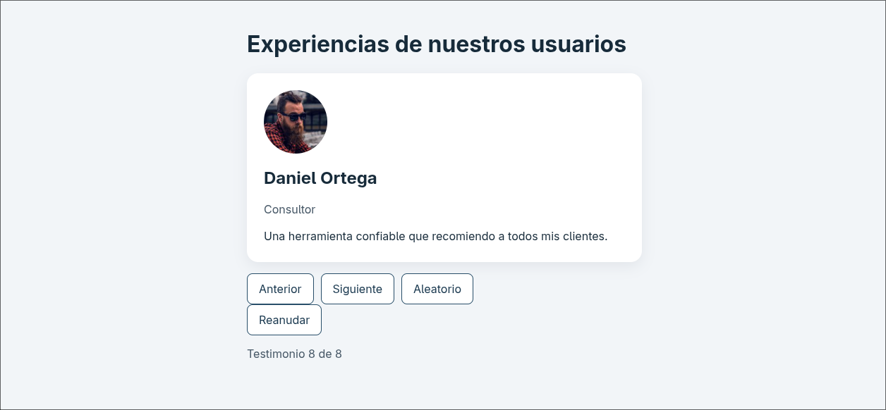

# Aplicación de Testimonios (React + Vite)

Práctica inicial de React · Ingeniería de Software · Unidad 3 · TECNM Celaya · AGO–DIC 2026

## Integrantes
- Sebastian (22030253@itcelaya.edu.mx)
- Pamela (APELLIDO / CORREO)

## Etapa terminada
Etapa básica completa (P01 a P10) **y** ampliación de reproducción automática (A01 a A07). Todo está integrado en la rama `main`.

## Versiones utilizadas
- Node: v26.9.0
- npm: 12.0.2
- React 19, Vite 8

## Instalación y ejecución
~~~bash
npm install
npm run dev        # desarrollo en http://localhost:5173
npm run build      # genera dist
npm run preview    # revisa la compilación localmente
~~~

## Estructura
~~~
src/
  components/
    Testimonial.jsx   # presenta un registro (props: item)
    Controls.jsx      # botones; comunica acciones por callbacks
  App.jsx             # conserva index y reproduciendo; navegación y efecto
  main.jsx            # monta App en #root
  data.js             # arreglo de 8 testimonios ficticios
  styles.css          # estilos
capturas/             # capturas 320, 768, 1280 px y tablero Scrum
PRUEBAS.md            # registro P01–P10 y A01–A07
~~~

## Decisiones principales
- App conserva el estado `index`; Testimonial solo presenta; Controls solo avisa mediante callbacks.
- Navegación circular con el operador `%`; en `prev` se suma `total` para evitar índices negativos.
- Aleatorio usa un salto entre 1 y total−1, así nunca repite el testimonio actual.
- Con 0 registros se muestra un mensaje; con 1 la interfaz funciona y no aparece Pausar/Reanudar.
- Fotos desde URLs remotas ficticias (pravatar); dependen de conexión.
- Se corrigió `lang="es"` y el título en `index.html` por accesibilidad.

## Reproducción automática (ampliación)
El avance cada 5 segundos se implementa con `useEffect`, porque el temporizador es un sistema externo al cálculo del JSX; un clic, en cambio, se maneja con un evento. El efecto crea el `setInterval` solo si `reproduciendo` es verdadero y hay al menos dos registros. Su función de limpieza (`clearInterval`) elimina el intervalo antes de que el efecto se ejecute de nuevo y al desmontar el componente; sin ella se acumularían intervalos y el autoplay se aceleraría, sobre todo con `StrictMode` en desarrollo. Las dependencias son `[reproduciendo, total]` y se usa `setIndex(actual => ...)` para no capturar un índice viejo. La reproducción inicia pausada, y cualquier navegación manual la detiene; solo Reanudar la activa. Se retiró `aria-live` del contador para no anunciar un cambio cada 5 segundos.

## Trabajo en pareja (Driver / Navigator)
| Misión | Driver | Navigator |
|--------|--------|-----------|
| 1. Proyecto base | Sebastian | Pamela |
| 2. Datos | Pamela | Sebastian |
| 3. Testimonial | Sebastian | Pamela |
| 4. Montaje y estilos | Pamela | Sebastian |
| 5. Controles y navegación | Sebastian | Pamela |
| 6. Registro de pruebas | Pamela | Sebastian |
| 7. Ampliación de datos | Sebastian | Pamela |
| 8. README | Pamela | Sebastian |
| 9. Autoplay | Sebastian | Pamela |

Los cambios de rol también quedan en el historial de commits.

## Pruebas
Ver [PRUEBAS.md](PRUEBAS.md).

## Capturas
### Móvil (320 px)

### Escritorio (1280 px)

### Entorno de desarrollo

## Reflexión: reutilización y productividad
- **Qué reutilicé:** el componente `Testimonial` se usa para los 8 registros; cambiar su estilo o estructura se hace en un solo lugar (`Testimonial.jsx` y `.testimonial-card`) en vez de repetir HTML ocho veces.
- **Frente al DOM manual:** sin React habría que buscar nodos y actualizar nombre, cargo, texto y foto a mano en cada clic; con React solo cambia el estado `index` y la interfaz se recalcula.
- **Qué es diseño mío y qué aporta React:** separar datos, tarjeta, controles y coordinación es una decisión de organización; React aporta componentes, props, estado y el renderizado.
- **Costo de React en una app pequeña:** requiere Node, Vite, dependencias y compilación, y una página así podría hacerse con HTML, CSS y JavaScript.
- **Duda pendiente:** (ESCRIBIR UNA PREGUNTA CONCRETA, por ejemplo cómo cambiaría el efecto si los datos llegaran de una API).